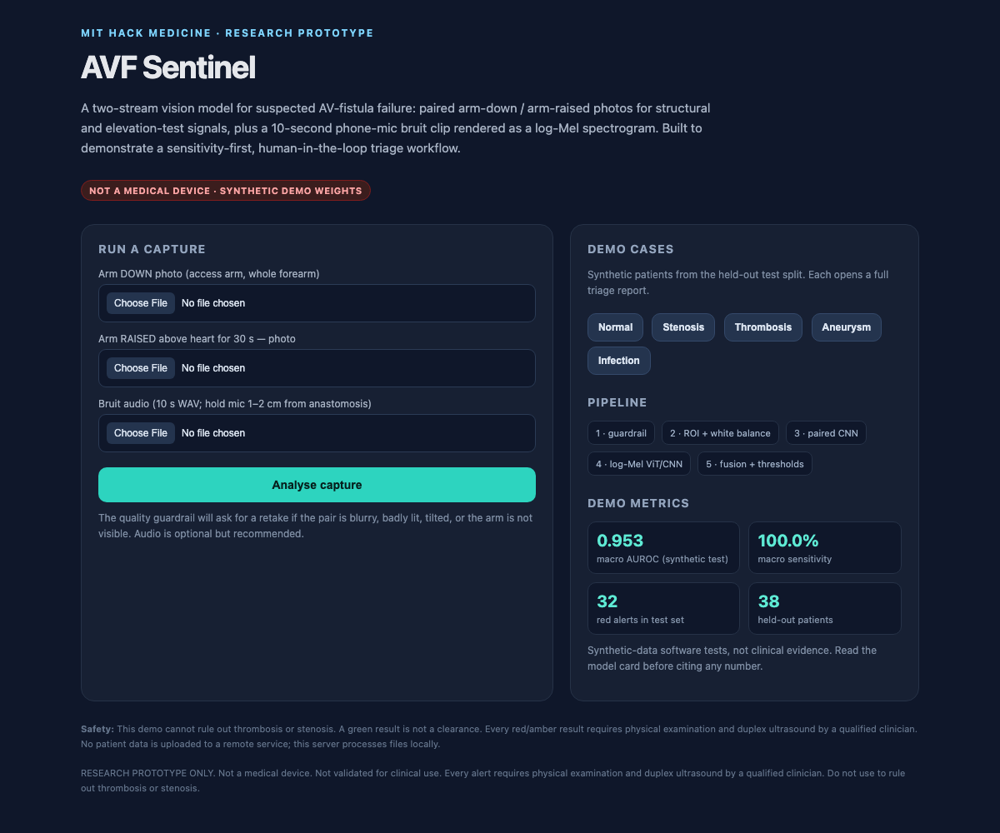

# AVF Sentinel

**A two-stream research prototype for AV-fistula thrombosis and stenosis triage.**

AVF Sentinel combines **paired arm-down / arm-raised phone photos** with a
**10-second phone-microphone bruit recording** and returns a sensitivity-first
`red / amber / green` triage plus a `retake` quality gate. It is built for an MIT
Hack Medicine demo and is deliberately honest about what it is:

> **Research prototype. Not a medical device. Not clinically validated.** All
> numbers in this repository come from a **synthetic cohort** and are software
> tests, not evidence that the model works on patients.



An example triage report for a synthetic thrombosis capture is in
[`docs/report_example.png`](docs/report_example.png).

---

## Why this problem

An arteriovenous fistula (AVF) is a dialysis patient's lifeline. When it fails —
thrombosis, outflow stenosis, aneurysm, infection, or hematoma — dialysis is
interrupted and the patient needs urgent access review. Most surveillance still
depends on physical examination (thrill/bruit), dialysis adequacy, and duplex
ultrasound. Those are effective but intermittent, operator-dependent, and hard to
deliver consistently between sessions.

The hypothesis behind this prototype is modest: a phone can capture **two
signals that nurses already use** — how the arm looks when raised (the elevation
test) and what the bruit sounds like — and a multimodal model can flag
high-risk patterns for human review. It is a triage aid, not a diagnosis.

## What it does

- **Five multi-label findings:** stenosis, thrombosis, aneurysm, infection,
  hematoma. Findings can co-occur.
- **Two image views, one encoder:** a shared ConvNeXt-Tiny embeds arm-down and
  arm-raised photos; fusion sees `[f_down, f_up, f_up−f_down, f_down⊙f_up]` so
  the elevation change is explicit.
- **Bruit as an image:** a 10-second clip becomes a 128×224 log-Mel spectrogram
  (absolute dB + local contrast) for a ResNet18, plus 16 handcrafted acoustic
  descriptors.
- **Capture guardrails:** blur, exposure, glare, tilt, and missing-arm checks
  can refuse to score and ask for a retake.
- **Sensitivity-first thresholds:** thrombosis targets 95% validation
  sensitivity; other findings target 90%. The amber band catches borderline
  cases; red routes to same-day review.
- **Patient-grouped splits, bootstrap CIs, subgroup audit, model card.**
- **Web demo and self-contained HTML report** with raw/processed photos,
  spectrogram, probabilities, thresholds, and safety language.

## Quickstart

Requires Python 3.10+ and ~2 GB of disk for the demo cohort/artifacts.

```bash
cd avf-sentinel
python3 -m venv .venv
source .venv/bin/activate
pip install -r requirements.txt

# Generate 300 synthetic patients, preprocess, train 14 epochs, make a report
./scripts/quickstart.sh
```

Or run the stages manually:

```bash
export PYTHONPATH=src

python -m avfsentinel.synth   --out data/synthetic --patients 300 --seed 7
python -m avfsentinel.prepare --data data/synthetic
python -m avfsentinel.train   --data data/synthetic --out artifacts/avf-demo \
    --epochs 14 --batch-size 12 --freeze-epochs 2

# CLI inference on one capture
python -m avfsentinel.infer --checkpoint artifacts/avf-demo/best.pt \
    --demo --scenario thrombosis --data data/synthetic \
    --out artifacts/avf-demo --report artifacts/avf-demo/demo_report.html

# Web demo
python -m avfsentinel.serve --checkpoint artifacts/avf-demo/best.pt
# open http://127.0.0.1:8000
```

You can also `pip install -e .` and use `avf-synth`, `avf-prepare`, `avf-train`,
`avf-infer`, and `avf-serve`.

### Faster smoke run

```bash
PATIENTS=80 EPOCHS=2 BATCH_SIZE=8 ./scripts/quickstart.sh
```

### Recalibrate an existing checkpoint

Thresholds and the model card can be regenerated without retraining (useful
after changing the operating-point policy):

```bash
PYTHONPATH=src python -m avfsentinel.train --data data/synthetic \
  --out artifacts/avf-demo --from-checkpoint artifacts/avf-demo/best.pt
```

### Tests

```bash
PYTHONPATH=src python -m unittest discover -s tests -v
```

## Demo results

Final run: 300 synthetic patients, patient-grouped 210/45/45 split, 38
quality-passing test patients, 14 epochs (early-stopped at epoch 12; best epoch
7), ConvNeXt-Tiny + ResNet18, Apple MPS, ~3 minutes of training.

| Finding | Test AUROC | Sensitivity | Specificity | PPV | n positive |
|---|---:|---:|---:|---:|---:|
| Outflow stenosis | 0.972 | 1.000 | 0.680 | 0.619 | 13 |
| Access thrombosis | 1.000 | 1.000 | 0.788 | 0.417 | 5 |
| Access aneurysm | 1.000 | 1.000 | 0.667 | 0.550 | 11 |
| Infection / erythema | 1.000 | 1.000 | 0.967 | 0.889 | 8 |
| Hematoma / bruising | 0.792 | 1.000 | 0.667 | 0.143 | 2 |
| **Macro** | **0.953** | **1.000** | **0.754** | — | — |

- Thresholds were chosen on the 39 quality-passing validation patients with a
  +0.05 sensitivity margin and a 0.80 validation-specificity floor, then frozen.
- Test triage: **32 red, 2 amber, 4 green**. The cohort is enriched for findings
  (27/38 test patients have at least one label), so a high red count is
  expected; specificity is the cost of the sensitivity-first operating point.
- Patient-level bootstrap 95% CIs and the skin-tone subgroup table are in
  `artifacts/avf-demo/metrics.json` and `MODEL_CARD.md`. Subgroup n is very
  small (23 light, 15 dark); treat those rows as illustrative only.
- Capture guardrail: **43/300 pairs rejected** (16 blur, 13 tilt, 10 dark,
  2 bright), with **2/254 false rejections on clean captures**. All 16 blur and
  13/13 angle cases were caught; 5 deliberately borderline dark/bright captures
  passed by design.

> These are **synthetic-data software tests**. The cohort is intentionally hard
> (skin tones I–VI, lighting casts, backgrounds, blur/tilt/exposure failures,
> ambient noise, missing bruit, co-occurring findings), but it is generated by
> code, not collected from patients. Do not cite these numbers as clinical
> performance.

## Repository layout

```
avf-sentinel/
├── src/avfsentinel/
│   ├── synth.py           synthetic image + audio cohort generator
│   ├── prepare.py         guardrails, ROI/white balance, caches, feature stats
│   ├── preprocessing.py   quality checks, shared pair crop/WB, paired features
│   ├── audio.py           WAV I/O, log-Mel, acoustic descriptors, bruit synth
│   ├── data.py            paired dataset + shared augmentation
│   ├── models.py          ConvNeXt/ResNet two-stream fusion + focal loss
│   ├── metrics.py         calibration, thresholds, triage, CIs
│   ├── train.py           training loop + artifacts + model card
│   ├── infer.py           CLI inference + self-contained HTML report
│   ├── serve.py           FastAPI upload/demo UI
│   ├── plots.py           training/ROC/calibration/preprocessing figures
│   ├── constants.py       classes, quality thresholds, audio config
│   └── utils.py           device selection, seeding, JSON helpers
├── scripts/
│   ├── quickstart.sh      end-to-end demo
│   ├── fetch_openi.py     open-access figures for qualitative inspection only
│   └── grouped_folds.py   patient-grouped stratified folds for real manifests
├── docs/
│   ├── ARCHITECTURE.md    model and pipeline details
│   ├── REAL_DATA.md       schema, labels, splits, governance
│   └── CLINICAL_PROTOCOL.md  capture and triage workflow, safety controls
├── tests/test_core.py     fast unit tests
├── requirements.txt
└── pyproject.toml
```

## How the pipeline works

```
photo pair ─► guardrail ─► shared crop + white balance ─► shared ConvNeXt-Tiny
                                                             │
                                              pair vector [down, up, Δ, ⊙]
                                                             │
bruit WAV ─► log-Mel ─► ResNet18 ─┐                          │
          └► 16 descriptors ──────┤                          │
                                  ├─► fusion MLP ─► 5 sigmoids ─► triage
12 paired-photo descriptors ──────┘                          │
                                                   red / amber / green / retake
```

Details: [`docs/ARCHITECTURE.md`](docs/ARCHITECTURE.md).

## The synthetic cohort

There is **no public, labelled, patient-level dataset** of paired AVF photos,
bruit audio, and duplex ground truth. To make the pipeline runnable and
testable today, `synth.py` renders a procedural cohort:

- 300 patients, split 210/45/45 (patient-grouped, stratified by scenario and
  skin-tone group);
- five scenarios (normal, stenosis, aneurysm, thrombosis, infection) plus
  co-occurring findings;
- Fitzpatrick I–VI tones, five background styles, lighting casts;
- realistic arm rendering with access-site vein, bulge, erythema, bruising;
- capture failures: blur, dark, bright, tilt;
- audio: laminar, turbulent, and absent bruit, ambient clinic noise, 50/60 Hz
  hum, random gain; 16 kHz WAV;
- quality guardrails are audited against the generator's known failure labels.

The generator is intentionally **not** a physiological simulator. It tests
software behavior and failure modes; it does not establish clinical validity.

## Real data

See [`docs/REAL_DATA.md`](docs/REAL_DATA.md) for the manifest schema, label
definitions, patient-grouped splits, sample-size guidance, and governance. The
short version:

1. Collect consented paired photos + bruit + duplex-adjudicated labels.
2. Build `manifest.csv`; run `scripts/grouped_folds.py` for patient-grouped folds.
3. Run `avf-prepare` and `avf-train` on `data/real`.
4. Freeze the test split, report CIs and skin-tone subgroups, and have
   clinicians review false negatives.

Open-access figures (`scripts/fetch_openi.py`) are for qualitative inspection
only. They are not a labelled cohort and must not be used to claim performance.

## Safety and limitations

- **Not a medical device.** No regulatory clearance. Do not use for patient care.
- **Cannot rule out thrombosis or stenosis.** A green result is not a clearance.
- **Synthetic training data.** Every metric is a software test.
- **No external validation.** No multi-site, multi-device, or prospective data.
- **Surface signals only.** Deep stenosis and inflow problems may not be visible.
- **Audio confounders.** Hypotension, needle infiltration, ambient noise, and
  microphone placement can change the bruit.
- **Sensitivity-first thresholds** deliberately produce false positives; alert
  fatigue must be monitored.
- **Equity.** Subgroup n is small in the demo. A real study must pre-register
  skin-tone, sex, age, access-type, and site analyses.
- **Privacy.** The demo runs locally; real deployment needs de-identification,
  encryption, access control, audit logging, and ethics approval.

The clinical workflow and stop rules are in
[`docs/CLINICAL_PROTOCOL.md`](docs/CLINICAL_PROTOCOL.md).

## What would make this real

1. A prospective, multi-site cohort with duplex-adjudicated labels.
2. Pre-registered operating points and subgroup analyses.
3. External validation on a held-out site and device.
4. Regulatory classification and clearance.
5. Integration with dialysis-unit workflow, EHR, and audit systems.
6. Post-market monitoring for drift, harm, and alert fatigue.

## License

MIT for the code. Synthetic data is generated locally. Open-access figures
fetched by `scripts/fetch_openi.py` retain their original licenses; cite the
source articles.
